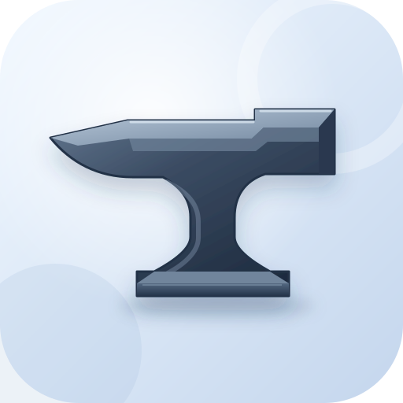

# Iron IDE ⚒️


> **Because code should be forged, not configured.**

Iron IDE is a next-generation lightweight development environment. No Electron. No extensions. No bloat. Just pure code, instant startup, and a unique visual system for understanding project structure.

## Why Iron?

| Feature | VS Code / JetBrains | Iron IDE |
| :--- | :--- | :--- |
| **Size** | 300 MB – 2 GB+ | **~36 MB** |
| **Languages** | Requires plugins | **18 languages out of the box** |
| **Architecture** | "Lego" made of extensions | **Monolithic core** |
| **Code Structure** | Flat text | **Visual block frames** |

## 🔥 Killer Features

### 1. Visual Code Frames
Forget endless indentation and collapsing blocks. Iron IDE automatically highlights code structure:
-   **Dashed frame** — around classes, interfaces, and OOP entities.
-   **Solid frame** — around functions, methods, and procedural blocks.

This changes how you perceive code: you see the architecture, not just text.

### 2. Everything Out of the Box (No Extensions)
We abandoned the extension system for stability and speed. Language support is built directly into the core:
# ✅ Python, Java, JavaScript, C#, Rust, D  
# ✅ C/C++, Go, Groovy, Scala, Kotlin, Lua  
# ✅ Basic, VBS, GDScript, Assembler, Pascal  

No version conflicts. No telemetry from third-party plugins. It just works.

### 3. Ultra-Lightweight
Thanks to JavaFX + JLink and the absence of Electron, Iron IDE weighs only **~36 MB**. That's less than a single phone photo, yet more powerful than most modern editors.

## 📦 Installation

### Linux (AppImage)
1. Download the latest release from the [Releases](https://github.com/Facts566/Iron-IDE/releases) page.
2. Make the file executable:
```bash
   chmod +x Iron-IDE-x86_64.AppImage
